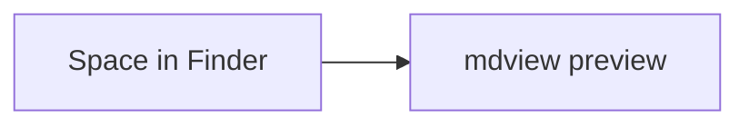

# Quick Look fixture

A paragraph with **bold**, *emphasis*, `code`, a [link](https://example.com), an
[anchor](#table) and a :rocket: shortcode. Inline math $e^{i\pi} + 1 = 0$.

$$
\int_0^1 x^2 \, dx = \frac{1}{3}
$$

```swift
let greeting = "Hello"
func greet() -> String { return greeting }
```

## Table

| Left | Center | Right |
|:-----|:------:|------:|
| a    | b      | c     |

- [x] done
- [ ] open

> [!NOTE]
> Alerts render with a title and icon.

A footnote reference[^1].

Raw HTML stays inert: <script>alert(1)</script> while <b>bold</b> renders.




[^1]: The footnote text.
